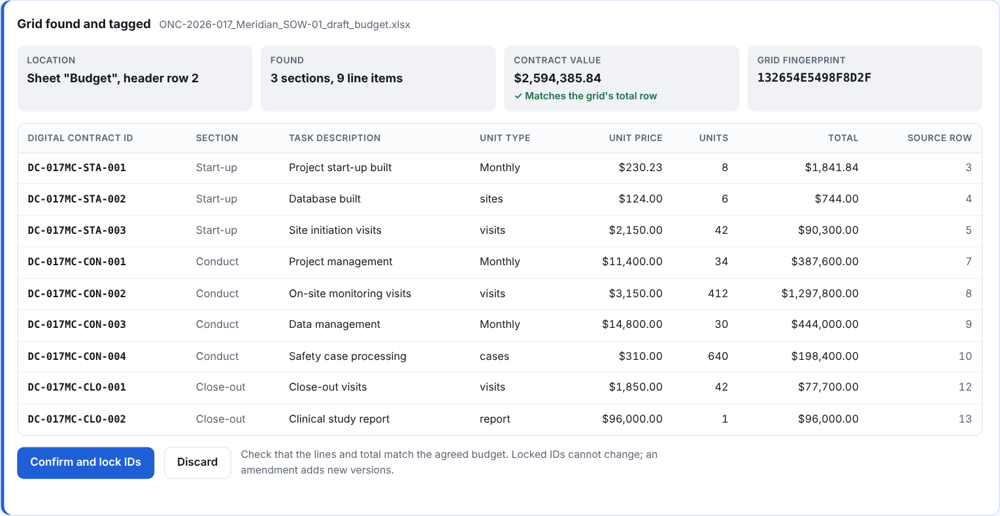
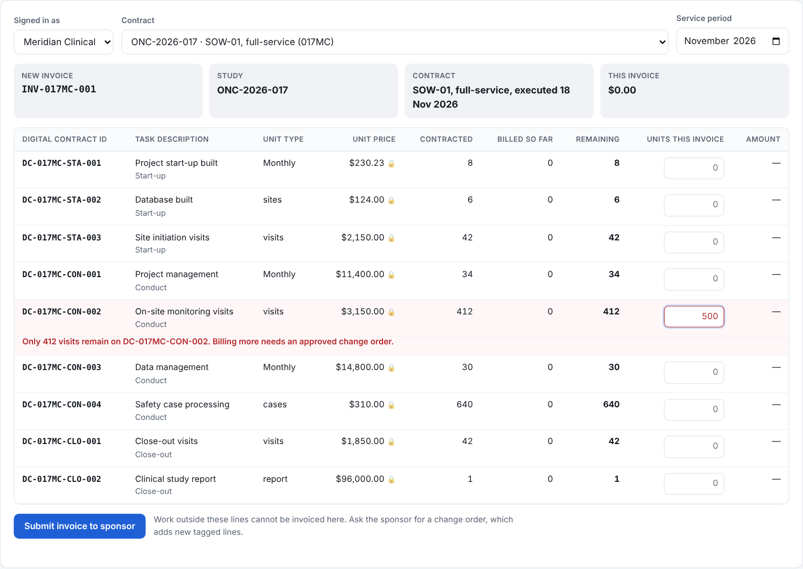
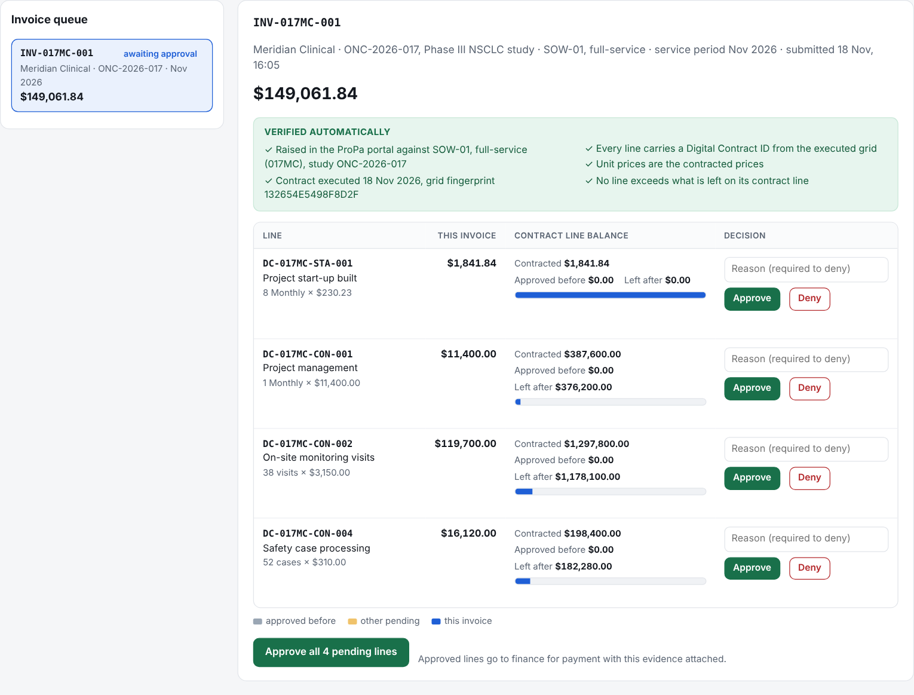
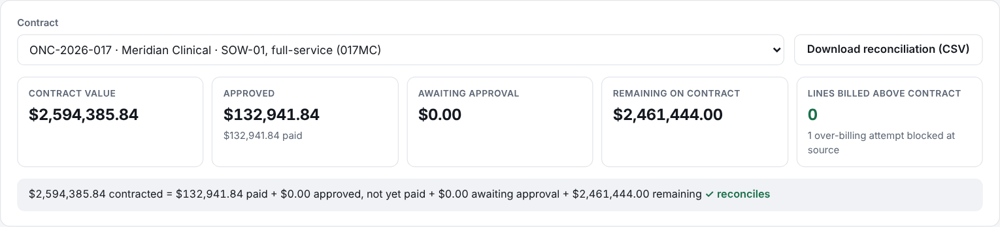

# ProPa: contract-to-invoice control prototype (Created by me) 

Demo link - https://propa-prototype-demo.streamlit.app/

**Every contract line, from signature to payment.**

ProPa gives every line of a contract's budget grid a permanent **Digital Contract ID** before the contract is signed. Every invoice line is then tied to one of those IDs, either quoted by the vendor or mapped by ProPa from the vendor's own invoice, so approvers see exactly which contract line each charge belongs to and what is left on it, and over-billing on a single line can't hide inside a PO total. It works alongside existing PO and payment systems such as Ariba, and the same way for FSO, FSP and hybrid agreements, because every SOW or contract carries a budget grid.

**Live demos:** the Streamlit app and the GitHub Pages prototype are linked in this repository's About section (or run them locally, below).

**Demo video (about 2 min):** [docs/propa-demo.mp4](docs/propa-demo.mp4): tagging the SOW, mapping an invoice, the PM decision, and how ProPa connects to the Ariba PO

**Common question:** [How does ProPa connect to the PO in Ariba without disturbing existing systems?](docs/ariba-po-integration.md)

> Prototype for discussion only. All studies, vendors and figures are synthetic. Uploaded files are processed in your session and not stored.

## Two demos in this repository

1. **Streamlit app: tag a contract, then map invoices to it** (`streamlit_app.py`).
   - Upload a final SOW or contract (.docx, .pdf, .xlsx or .csv) that has a budget grid and no IDs. ProPa finds the grid inside the contract, checks the totals, assigns a Digital Contract ID to every line and returns the SOW with the IDs written into its budget table, plus an ID register (.xlsx, and .json for P2P/ERP).
   - Then upload a vendor invoice that quotes only the SOW's single PO number and its own descriptions. ProPa maps each invoice line to its Digital Contract ID using the description, unit price and unit type, explains every match, and checks what is left on each line. It shows the difference between a PO-level check (the sample invoice passes) and ProPa's line-level check (two lines over contract, one price difference and one charge outside the contract). The PM confirms uncertain matches, and confirmed wording is remembered for the next invoice.
   - Samples in `samples/`: a SOW with no IDs (.docx, .pdf) and a vendor invoice with no IDs (.pdf, .xlsx). Parties and figures are fictional.
2. **Browser prototype: the full loop** (`index.html`). Tagging, execution check, vendor invoicing, approval, payment and reconciliation.

### Run the Streamlit app

```
pip install -r requirements.txt
streamlit run streamlit_app.py
```

To publish it, sign in at [share.streamlit.io](https://share.streamlit.io) with GitHub, choose **Create app**, pick this repository, branch `main` and main file `streamlit_app.py`, then **Deploy**.

## The flow

| Step | Who | What happens in ProPa |
| --- | --- | --- |
| 1. Run the draft | Outsourcing manager | Once both parties agree to go for signature, the draft's budget grid (.xlsx, .xls or .csv) is run through ProPa. It finds the grid, reads sections and line items, checks each total against unit price × units and the grid's total row, and assigns a Digital Contract ID to every line. |
| 2. Lock and execute | Outsourcing manager | IDs are locked and the grid is fingerprinted. The tagged grid can be downloaded for the contract's budget appendix. Before execution is recorded, the executed copy can be checked line for line against what was tagged; any change blocks execution. |
| 3. Invoice in the portal | Vendor | The vendor raises invoices inside ProPa by entering units against its contracted lines. Unit prices come from the contract, and a line cannot be billed beyond its remaining units. Work outside the contract cannot be invoiced; it needs a change order. |
| 4. Approve or deny | Sponsor approver (PM) | Each invoice arrives verified: study, contract, execution, IDs, contracted prices and balances. For every line the approver sees what was contracted, what was approved before and what will be left, then approves or denies with a reason the vendor can see. |
| 5. Pay and reconcile | Finance | Finance pays exactly the approved lines and sees every contract line's balance. Contract value = paid + approved not yet paid + awaiting approval + remaining. |

Everything is written to an audit log: who did what, and when.






## Try it

1. Open the live demo, or download this repository and open `index.html` in Chrome, Edge or Firefox. There is no build step and no server.
2. **Outsourcing manager:** click **Use the sample draft**, or upload `samples/ONC-2026-017_Meridian_SOW-01_draft_budget.xlsx`. Click **Confirm and lock IDs**, then **Record execution**. To see the executed-copy check fail, upload `samples/..._executed_CHANGED.xlsx` there; the matching copy is `samples/..._executed_budget.xlsx`.
3. **Vendor portal:** enter units on a few lines. Try more units than remain to see the block. Submit.
4. **Approver:** approve lines, or deny one with a reason.
5. **Finance:** record the payment, check the reconciliation and download it as CSV.
6. **Reset demo** clears everything.

You can also upload your own budget grid. ProPa looks for columns for task description, unit type, unit price, number of units and total cost, in any order, on any sheet. Rows with only a description are read as section headings; rows starting with "Total" are used to check the grid's sum.

## What is in the repository

```
streamlit_app.py    Streamlit app: upload a SOW, tag its budget grid
propa/              Python engine: grid detection and IDs (grid.py), reading and writing documents (documents.py), invoice-to-ID matching (matching.py)
requirements.txt    Python dependencies for the Streamlit app
index.html          browser prototype: app shell
css/styles.css      styles
js/grid.js          grid detection, Digital Contract IDs, fingerprint, executed-copy comparison
js/app.js           the five role screens, rules and audit log
js/sample.js        built-in sample grid (same as the sample .xlsx)
samples/            sample SOW and vendor invoice with no IDs; draft, executed and changed budget grids (.xlsx, .csv)
vendor/             SheetJS spreadsheet reader (Apache 2.0)
docs/               demo video and screenshots
```

## Rules the prototype enforces

- A line's ID never changes once locked; an amendment would add new IDs or versions (not built yet).
- Execution cannot be recorded if the executed copy's grid differs from the tagged grid.
- Vendors cannot change unit prices or invoice a line beyond its remaining units, counting pending invoices.
- Denials require a reason; every decision is timestamped and shown to the vendor.
- Finance can pay only lines an approver approved.

## Not in this prototype

Change orders and amendments, users and permissions, a server or database, ERP/AP integration (for example SAP Ariba), e-signature, invoice PDFs, tax and currency, and pass-through costs billed at actuals. These are the obvious next steps for a pilot.

## Running the checks

The prototype was tested end to end in headless Chrome: grid detection on .xlsx and .csv, ID assignment, executed-copy mismatch, the over-billing block, approve and deny rules, payment, CSV exports and reload persistence.
